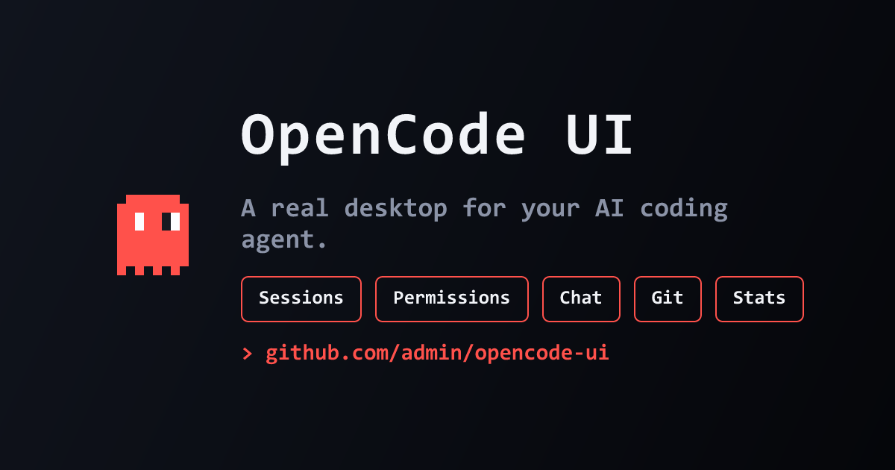
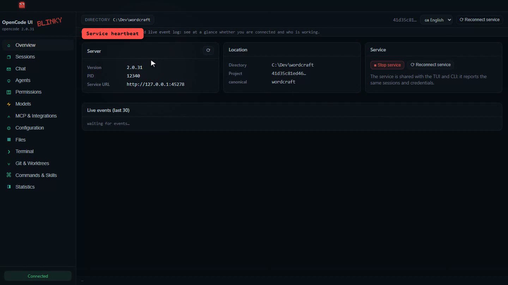
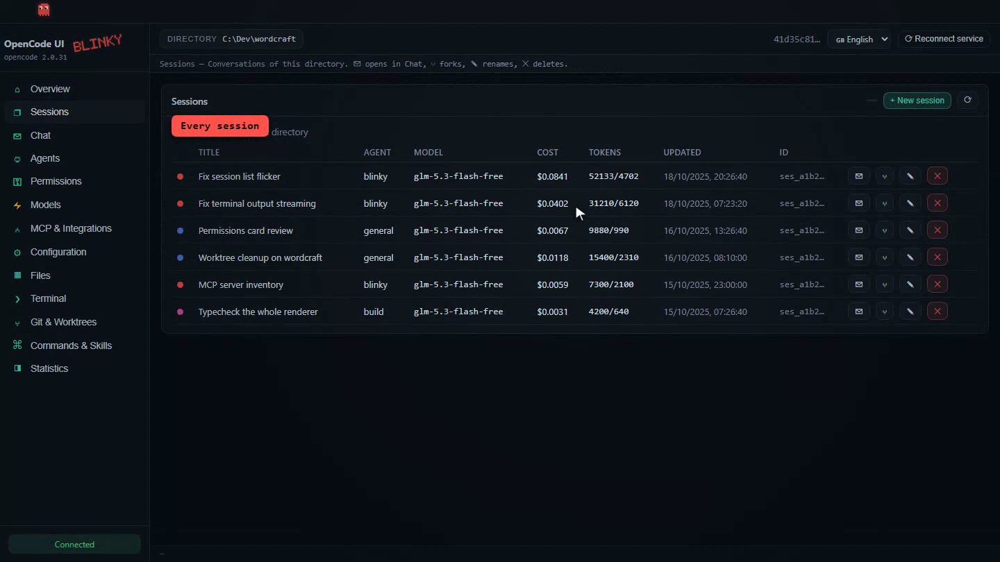
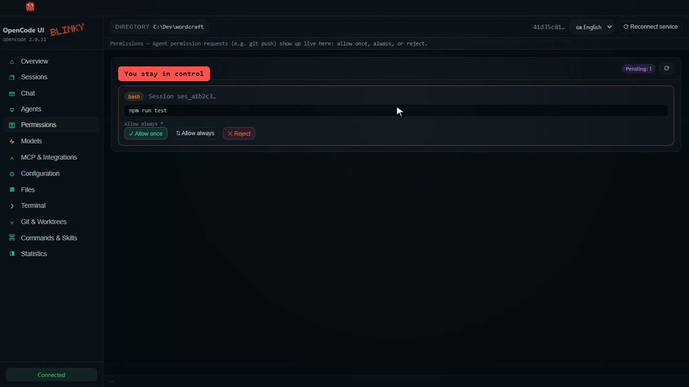
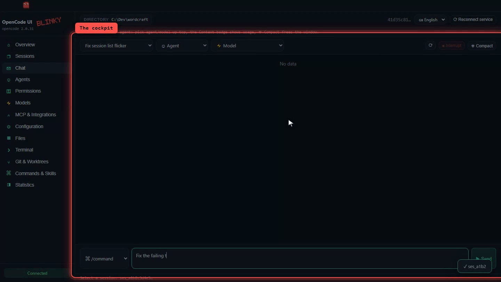
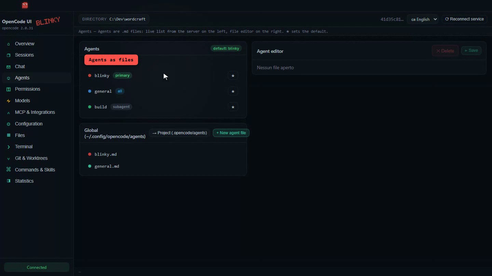
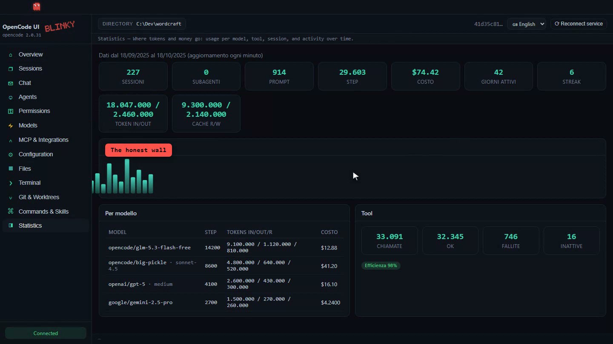

<div align="center">



# OpenCode UI

## Your whole AI coding team, behind one window.

[](LICENSE)
[](#-getting-started)
[](https://www.electronjs.org/)
[](https://react.dev/)
[](https://www.typescriptlang.org/)
[](https://opencode.ai/)

**[▶ Watch the 80-second demo](https://github.com/marcot3ssar1/opencode-ui/raw/main/docs/media/demo_tiktok.mp4)** ·
[Download v0.1.0](https://github.com/marcot3ssar1/opencode-ui/releases) ·
[Report a bug](../../issues) ·
[Request a feature](../../issues)

*Linux · macOS · Windows — MIT licensed*

**[📖 Leggi la documentazione in italiano](docs/README.it.md)**

</div>

---

## 👻 Why OpenCode UI exists

[**OpenCode**](https://github.com/sst/opencode) is a terminal-native AI coding
agent. Powerful — but invisible: the moment you run more than one agent, or want
to see what your agents did yesterday / what they cost / what they may touch,
you are stuck with `grep`-ing logs and juggling terminals.

**OpenCode UI gives that power a real desktop home.**

- **One window** — every agent, session, repository and credential in one place
- **Never out of sync** — the app attaches to the *same shared service* that the
  CLI and the TUI drive, so it reports identical sessions, credentials and
  configuration (`@opencode/client` → `Service.ensure()`)
- **A live guard ghost** — Blinky watches the service and *sprints* every time
  an agent starts working
- **Honest numbers** — every token, every tool call and every dollar is one
  click away, straight from OpenCode's own stats API

<div align="center">

| [](docs/media/shot_home.jpg) | [](docs/media/shot_sessions.jpg) | [](docs/media/shot_permissions.jpg) |
|:---:|:---:|:---:|
| **Overview** — service heartbeat | **Sessions** — full history, fork, rename | **Permissions** — approve once / forever |
| [](docs/media/shot_chat.jpg) | [](docs/media/shot_agents.jpg) | [](docs/media/shot_stats.jpg) |
| **Chat** — streaming cockpit | **Agents** — edit agents as files | **Statistics** — the honest wall |

</div>

## ✨ What you get — all 13 views

| View | What it manages |
|---|---|
| **Overview** | service state, server/location info, live event log |
| **Sessions** | per-directory session list, create, fork, rename, delete |
| **Chat** | streaming messages, agent/model switching, interrupt, compact, slash commands |
| **Agents** | live agent list + editor for agent `.md` files (global & project), `default_agent` |
| **Permissions** | live requests with allow-once / always / deny |
| **Models** | providers & models with limits and $/M pricing |
| **MCP & Integrations** | MCP servers (add/remove/connect/disconnect), resources, integrations, credentials |
| **Configuration** | editor for the global `opencode.jsonc`, project config and the TUI's `cli.json` |
| **Files** | project browser + editor through OpenCode's filesystem API |
| **Terminal** | shell commands, persistent in the service, with streamed output |
| **Git & Worktrees** | status, branches, diffs, worktree create/remove/refresh |
| **Commands & Skills** | command/skill catalog, run them on the selected session |
| **Statistics** | model/tool usage, costs, activity and streaks |

## 🚀 Getting started

### Requirements

- [OpenCode](https://opencode.ai/) **V2** installed and on your `PATH` (tested
  against `opencode 2.0.31` / `@opencode/client 2.0.32`)
- **Node.js ≥ 22**

### Run from source

```sh
git clone https://github.com/marcot3ssar1/opencode-ui.git
cd opencode-ui
npm install
npm run dev
```

`npm run dev` starts Electron with reload. The app discovers the OpenCode
service automatically (or launches it); the status pill in the sidebar turns
green when connected.

### Build an installer

```sh
npm run build     # verify the build into out/
npm run dist      # build + NSIS installer into dist/ (Windows)
```

Other platforms work with `electron-builder` targets (`--mac`, `--linux`) — the
NSIS target is the one packaged and tested end-to-end.

## 🏗 Architecture

- `src/main` — Electron main process: service discovery, HTTP client, the SSE
  event bridge (`/api/event`, live-only with reconnect + re-snapshot), and safe
  access to the global configuration files.
- `src/preload` — typed IPC bridge (`contextIsolation` ON, `nodeIntegration` OFF).
- `src/renderer` — React + TypeScript, inline IT/EN i18n, **no external backend**.

Views never talk HTTP directly: everything flows through the `bridge:request`
channel, and events stream in through `bridge:event`. Location-scoped calls pass
`?location[directory]=…`, so the UI can be attached to any of your project
directories.

**Security model** — the renderer is sandboxed; only the main process touches
the filesystem/OpenCode API; dangerous agent operations are surfaced as
*permissions* through OpenCode itself (see Blinky below).

## 👻 Blinky — the mascot that actually does something

Blinky is shipped as a regular [OpenCode agent file](examples/blinky.agent.md) —
drop it in `~/.config/opencode/agents/blinky.md` and:

- the **Agents** view shows him in red and lets you promote him to
  `default_agent`
- the **Chat** view preselects visible agents including him
- his `ask` permissions (`git push`, `npm publish`, `git reset --hard`,
  reading `.env` files...) appear **live** in the Permissions view while he works

Like the red Pac-Man ghost: straight toward the objective, tests before "done",
one clarifying question when in doubt.

## 🌐 Languages

The interface ships in **English** and **Italian** (switcher in the title bar).
Missing translations fall back to Italian; PRs for more languages are welcome.

## 🧪 Compatibility notes

- The client is pinned to `@opencode/client 2.0.32` for coherence with
  `opencode 2.0.31`.
- Some upstream routes (sessions, fs, config) are marked *experimental* by
  OpenCode: the UI follows their evolution, so also expect pinned-version bumps.
- The app writes config files as validated text (JSON5) — the TUI-friendly
  comments in those files are preserved when you edit with the textual editor.

## 🗺 Roadmap

- [ ] Interactive PTY terminal (`/api/pty/*` — mapped in the API, not exposed in v1)
- [ ] Session search & multi-session dashboards
- [ ] Auto-updates + `--mac`/`--linux` installer recipes
- [ ] More languages (FR? ES? — yours first, open an issue!)

## 🤝 Contributing

Issues and PRs are open. For large changes, please open an issue first so we can
align on direction. Run `npm run typecheck` before pushing.

## 📄 License

[MIT](LICENSE) © 2026 marcot3ssar1 — built on top of the brilliant
[OpenCode](https://github.com/sst/opencode) by [SST](https://sst.dev/).

<sub>The 80-second demo video and the screenshots in this README were produced
end-to-end by an automated recording pipeline, using the same OpenCode UI you
are looking at. Blinky is watching. 👻</sub>
